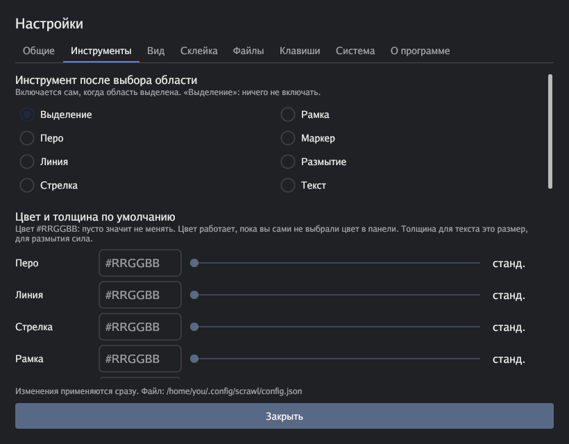

# Scrawl

**Быстрые скриншоты с аннотациями для GNOME на Wayland.** Нажали клавишу,
выделили область на любом мониторе, нарисовали стрелки, рамки и текст, замазали
личное, и результат уже в буфере обмена и сохранён в файл.

[English](README.md) · [Русский](README.ru.md) · [简体中文](docs/translations/README.zh-CN.md) · [Español](docs/translations/README.es.md) · [Português (Brasil)](docs/translations/README.pt-BR.md) · [日本語](docs/translations/README.ja.md) · [Deutsch](docs/translations/README.de.md) · [Français](docs/translations/README.fr.md) · [한국어](docs/translations/README.ko.md)


*Картинка это настоящая отрисовка оверлея поверх вымышленного рабочего стола.*

## Зачем нужен Scrawl

В GNOME с Wayland программы не могут снимать экран напрямую. Они просят об этом
портал рабочего стола, а портал **при каждом снимке спрашивает «какой экран
показать?»**. Scrawl спрашивает один раз на монитор и запоминает ответ, дальше
скриншот это одна клавиша: замороженный экран появляется примерно за 150 мс.

## Возможности

**Снимок**
- Работает на всех мониторах сразу: оверлей открывается на каждом, выделять можно на любом.
- Выделение с пунктирной рамкой. Угол тянут, чтобы изменить размер; с инструментом
  «выделение» можно тянуть за край или двигать область за середину.
- Пока тянете рамку, рядом с курсором появляется лупа: пиксели крупно (6×), сторона рамки видна
  на сетке пикселей, так что выровнять её можно точно (в настройках лупу можно выключить).
- Запоминает прошлую область и возвращает её одной клавишей (`R`).
- По желанию курсор мыши попадает в снимок (пока только в Wayland).

**Аннотации**
- Перо, линия, стрелка, рамка, маркер, **размытие**, текст и **штампы с номерами** (клик ставит кружок с 1, 2, 3 и так далее, как во flameshot); восемь цветов.
- Колесо мыши (или кнопки `−` / `+`) меняет толщину, размер текста или силу размытия.
- **Размытие** меняет вид вместе с силой: 1-10 мягкое размытие по Гауссу, 11-20 мозаика, 21-30 матовое стекло (сильное размытие с белой дымкой и тонкой рамкой). Клетки мозаики отсчитываются от угла области, а плашка при смене силы называет режим.
- Отмена по `Ctrl+Z`.

**Сохранить и отправить**
- `Enter` копирует картинку в буфер обмена и сохраняет PNG в `~/Pictures/Screenshots`.
  `Ctrl+C` только копирует, `Ctrl+S` только сохраняет. Есть и JPEG.
- **Подборки «было/стало»:** откладываете снимки клавишей `A`, потом склеиваете их в одну
  картинку с подписями («Было», «Стало» или «Шаг 1…» для большего числа), рядом или друг под другом.
  Или отправляете подборку отдельными файлами: они вставляются в чат как вложения.

**Под себя**
- Окно настроек почти на всё: клавиши, цвета, инструменты по умолчанию, вид выделения, имена и формат файлов и язык интерфейса (9 языков: русский, английский, китайский, испанский, португальский, японский, немецкий, французский, корейский).
- Значок в трее с автозапуском, кнопка назначения горячей клавиши и необязательная проверка обновлений (по умолчанию выключена).

## Статус

Личный проект в активной разработке. **Релизов пока нет**, поэтому сейчас программу
нужно собрать из исходников (это несколько минут). Linux: основная цель это GNOME на Wayland. **Сеансы X11** (GNOME на Xorg, KDE, XFCE и другие)
тоже работают, но эта поддержка новая и пока проверена только на виртуальном X-сервере, так что
отчёты с настоящих машин нужны. Под Windows код собирается, но захвата экрана там ещё нет:
см. [docs/WINDOWS.md](docs/WINDOWS.md).

## Требования

- GNOME на Wayland с PipeWire, `xdg-desktop-portal` (1.21 или новее, нужна регистрация
  приложений) и `xdg-desktop-portal-gnome`. Разрабатывалось и проверялось на Ubuntu с GNOME 50.
- `wl-clipboard` (команда `wl-copy`) для буфера обмена и `libnotify` (команда
  `notify-send`) для уведомлений.
- В **X11** портала нет: экран снимается напрямую, а для буфера обмена вместо
  `wl-clipboard` нужен `xclip`.

```bash
sudo apt install wl-clipboard libnotify-bin   # Wayland
sudo apt install xclip libnotify-bin          # X11
```

## Установка

### 1. Получите программу

**Из исходников** (работает уже сейчас):

```bash
sudo apt install gcc pkg-config patch libwayland-dev libx11-dev libx11-xcb-dev \
  libxkbcommon-x11-dev libgles2-mesa-dev libegl1-mesa-dev libffi-dev \
  libxcursor-dev libvulkan-dev libpipewire-0.3-dev
git clone https://github.com/jexme/scrawl.git && cd scrawl
make install            # собирает и ставит в ~/.local (PREFIX=/usr/local для всей системы)
```

Нужен Go (версия из `go.mod`). Нет `sudo`? `scripts/fetch-pipewire-headers.sh`
распакует заголовки PipeWire в `.deps/`, Makefile их подхватит.

**Из архива релиза** (когда версия выйдет): скачайте `scrawl-ВЕРСИЯ-linux-amd64.tar.gz`
и `SHA256SUMS` со страницы [Releases](https://github.com/jexme/scrawl/releases), затем:

```bash
sha256sum -c --ignore-missing SHA256SUMS
tar xzf scrawl-*-linux-amd64.tar.gz && cd scrawl-*-linux-amd64
./install.sh            # в ~/.local (PREFIX=/usr/local для всей системы)
sudo apt install libpipewire-0.3-0 libwayland-client0 libwayland-egl1 libwayland-cursor0 \
  libxkbcommon-x11-0 libegl1 libx11-6 libxcursor1
```

Проверьте, что `~/.local/bin` есть в `PATH`.

### 2. Первый запуск: три шага один раз

*В X11 шаги 1 и 2 не нужны (портала нет), только горячая клавиша.*

Откройте окно настроек (`scrawl -settings`, вкладка «Система») и нажмите кнопки, либо выполните команды:

1. **Выберите мониторы:** кнопка «Выбрать мониторы заново» или `scrawl -setup`.
   GNOME покажет по диалогу **на каждый монитор**. В каждом выберите *другой* монитор,
   оставьте галочку **«Запомнить этот выбор»** и согласитесь. Дальше диалогов не будет.
2. **Выдайте запасное разрешение:** кнопка «Выдать разрешение» или `scrawl -grant-screenshot`.
   Оно нужно, чтобы в редкий момент, когда PipeWire не отдал кадр, Scrawl мог взять
   более медленный Screenshot portal.
3. **Назначьте горячую клавишу:** поле «Горячая клавиша запуска» и кнопка «Назначить»
   (по умолчанию `Print`), либо `scripts/gnome-hotkey.sh [КЛАВИША]`. Создаётся
   пользовательский ярлык GNOME, занятую комбинацию он не перезаписывает. Если `Print`
   всё ещё открывает встроенный снимок GNOME, отключите его в
   *Параметры → Клавиатура → Просмотр и настройка сочетаний клавиш → Снимки экрана*.

### Обновление с screen-editor

Scrawl это новое название screen-editor. Пока нет файла `~/.config/scrawl/config.json`,
настройки берутся из `~/.config/screen-editor/config.json` (старый файл не меняется).
Выбор мониторов и разрешения portal привязывает к идентификатору приложения, а он сменился:
один раз повторите шаги 1-3 и перенаправьте горячую клавишу на `scrawl`.
Прошлая область и подборка начнутся заново.

## Как пользоваться

1. Нажмите горячую клавишу. Экран замрёт и потемнеет.
2. Выделите область мышью (на любом мониторе). Под ней появится панель инструментов.
3. При желании добавьте аннотации: выберите инструмент и цвет, рисуйте по области.
4. Нажмите `Enter`. Картинка в буфере обмена и в `~/Pictures/Screenshots`, вставляйте куда угодно.

`Esc` отменяет всё в любой момент.

### Клавиши

| Клавиша | Действие |
| --- | --- |
| `Enter` | копировать в буфер обмена **и** сохранить в файл (что именно, настраивается) |
| `Ctrl+C` / `Ctrl+S` | только копировать / только сохранить |
| `Ctrl+Z` | отменить последнюю аннотацию |
| `Esc` | отмена |
| `R` | вернуть область прошлого снимка |
| `V` `P` `L` `W` `B` `M` `U` `T` `N` | инструменты: выделение, перо, линия, стрелка, рамка, маркер, размытие, текст, штамп с номером (когда область выбрана) |
| `+` / `-` | толщина, размер текста или сила размытия текущего инструмента (как колесо мыши) |
| `A` | добавить снимок в подборку |
| `G` | склеить подборку (и текущую область) в одну картинку |
| `D` | сохранить подборку отдельными файлами и положить список файлов в буфер обмена |
| колесо мыши | толщина, размер текста или сила размытия текущего инструмента |

Любую клавишу можно поменять в окне настроек (вкладка «Клавиши»).

### Панель инструментов

Основной ряд слева направо: выделение, перо, линия, стрелка, рамка, маркер, размытие, текст, штамп
с номером · отмена · копировать · сохранить · меню `⋯` (настройки, они закрывают оверлей и открывают
окно настроек, и «в подборку») · закрыть.

Пока включён рисующий инструмент, под ним появляется второй ряд: восемь цветов, радужная кнопка
своего цвета (открывает палитру, цвет запоминается) и `−` толщина `+`. У «выделения» ни цвета, ни
толщины нет, поэтому ряд скрыт.

Под кнопками, у которых есть клавиша, она подписана (клавиши берутся из настроек).

### Подборки «было/стало»

Сделайте первый снимок и нажмите `A`. Делайте следующий: прошлая область уже выделена,
так что вы снимаете то же место ещё раз. `G` склеит снимки в одну картинку (она
сохранится и скопируется), `D` даст отдельные файлы. Маленькая панель внизу экрана
показывает, что лежит в подборке, и повторяет те же действия кнопками.

## Значок в трее и автозапуск

`scrawl -tray` держит значок в области уведомлений: левый клик делает снимок, в меню
«Снимок», «Настройки» и «Выход». Чтобы значок запускался при входе в систему, включите
*Настройки → Система → Автозапуск*. В GNOME для значка нужно расширение AppIndicator
(в Ubuntu оно включено по умолчанию).

## Настройки



Открываются шестерёнкой на панели, командой `scrawl -settings` или из меню приложений.
Изменения сохраняются сразу в `~/.config/scrawl/config.json`, это обычный JSON-файл,
его можно править и руками. Пропущенные и неверные значения заменяются значениями
по умолчанию. Каждый ключ описан в [справочнике по настройкам](docs/SETTINGS.ru.md).

## Файлы и приватность

- Картинки лежат в `~/Pictures/Screenshots` (меняется в настройках) и называются вроде `scrawl-20260131-142501.png`.
- Настройки: `~/.config/scrawl/`. Токены мониторов, прошлая область и подборка: `~/.cache/scrawl/`.
- Scrawl сам в интернет не ходит. Единственный сетевой запрос в программе это необязательная
  проверка обновлений (по умолчанию выключена): она спрашивает у GitHub последний релиз,
  и кроме обычных HTTP-заголовков отправляет только версию программы.
- Снимки не покидают ваш компьютер, пока вы сами их куда-нибудь не вставите.

## Командная строка

| Флаг | Что делает |
| --- | --- |
| `-settings` | открыть окно настроек |
| `-setup` | заново выбрать мониторы (диалоги GNOME) |
| `-grant-screenshot` | выдать запасное разрешение на снимок и выйти |
| `-tray` | держать значок в области уведомлений |
| `-fresh` | не предлагать область прошлого снимка |
| `-v` | печатать замеры времени |
| `-version` | показать версию и выйти |

## Если что-то не работает

- **По горячей клавише ничего не происходит.** Возможно, завис `xdg-desktop-portal`.
  Перезапустите его: `systemctl --user restart xdg-desktop-portal xdg-desktop-portal-gnome`.
- **GNOME спрашивает, какой экран показать, при каждом снимке.** Не стояла галочка «Запомнить этот выбор»: повторите шаг 1.
- **Добавили или заменили монитор.** Выберите мониторы заново (шаг 1).
- **Оверлей открывается только на одном мониторе.** То же: шаг 1 нужно пройти для каждого монитора.
- **Пишет, что portal отказал.** Выдайте разрешение (шаг 2).
- **В какую-то программу ничего не вставляется.** Проверьте, что установлен `wl-copy` (пакет `wl-clipboard`).
- **Нет уведомлений.** Установите `libnotify-bin` (команда `notify-send`) и проверьте, что уведомления включены в настройках.
- **Нет значка в трее.** Включите расширение GNOME AppIndicator.
- **`Print` открывает снимок GNOME.** Отключите его в сочетаниях клавиш (см. шаг 3).

## Как это устроено

Scrawl снимает экран через интерфейс ScreenCast `xdg-desktop-portal` собственным небольшим
клиентом PipeWire (`internal/pwcapture`). Сохранённый токен восстановления на каждый
монитор убирает диалог. Композитор (Mutter) отдаёт кадры, только когда монитор
перерисовывается, а над полноэкранным окном (прямой вывод) в наших замерах не отдал ни одного;
если кадр не пришёл за 250 мс, Scrawl берёт Screenshot portal: он медленнее (около 0,5-1 с).
Оверлеи это полноэкранные окна [Gio](https://gioui.org), по одному на монитор; Gio
пропатчен (`third_party/gio.patch`), чтобы ставить окно на нужный вывод Wayland.
Итог рисуется тем же кодом, что и экран, поэтому сохранённая картинка совпадает с тем, что вы видели.

## Сборка и участие

```bash
make build    # bin/scrawl; при первом запуске скачивает и патчит Gio
make test     # тесты, в том числе значок в трее на шине D-Bus сеанса
make dist     # архив релиза и контрольная сумма в dist/
make notices  # пересобрать THIRD_PARTY_NOTICES.md
```

Тексты интерфейса лежат в `internal/i18n/` (по файлу на язык; исходные тексты в коде русские);
`go test ./...` проверяет, что каждый текст переведён на каждый язык. Как сообщить об ошибке и предложить правку: [CONTRIBUTING.md](CONTRIBUTING.md) (по-английски). План и идеи: [docs/PLAN.md](docs/PLAN.md).

## Лицензия

MIT, см. [LICENSE](LICENSE). Сторонние компоненты: [THIRD_PARTY_NOTICES.md](THIRD_PARTY_NOTICES.md)
(формы значков из [Tabler Icons](https://tabler.io/icons), MIT).
