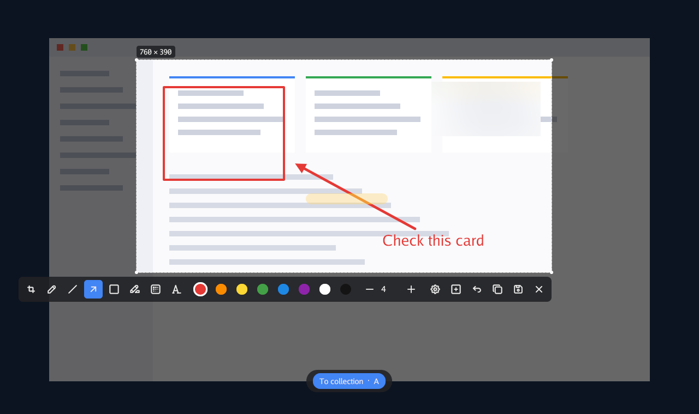
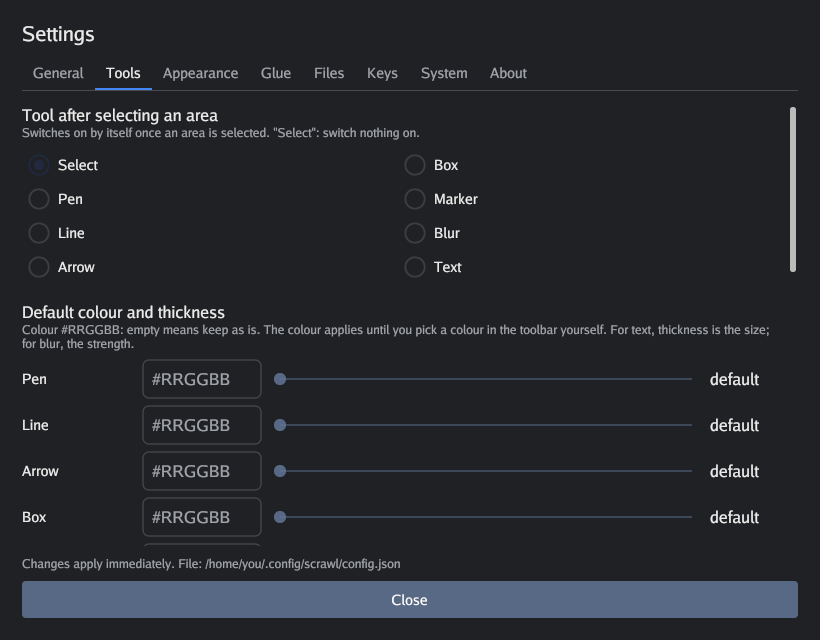

# Scrawl

**Schnelle Screenshots mit Anmerkungen für GNOME unter Wayland.** Taste drücken, auf einem beliebigen Monitor einen Bereich auswählen, Pfeile, Rahmen und Text zeichnen, Privates unkenntlich machen – und das Ergebnis liegt schon in der Zwischenablage und als Datei auf der Platte.

[English](../../README.md) · [Русский](../../README.ru.md) · [简体中文](README.zh-CN.md) · [Español](README.es.md) · [Português (Brasil)](README.pt-BR.md) · [日本語](README.ja.md) · **Deutsch** · [Français](README.fr.md) · [한국어](README.ko.md)



*Das Bild ist eine echte Darstellung des Overlays über einem erfundenen Desktop.*

> Die Oberfläche des Programms gibt es derzeit auf Englisch und Russisch; die unten genannten Schaltflächen heißen wie in der englischen Oberfläche.

## Warum Scrawl

Unter GNOME mit Wayland können Programme den Bildschirm nicht direkt aufnehmen: Sie bitten das Desktop-Portal darum, und das Portal **fragt bei jedem Screenshot „Welchen Bildschirm möchten Sie freigeben?“**. Scrawl fragt einmal pro Monitor, merkt sich die Antwort, und danach ist ein Screenshot ein einziger Tastendruck: Der eingefrorene Bildschirm erscheint nach etwa 150 ms.

## Funktionen

**Aufnahme**
- Funktioniert auf allen Monitoren gleichzeitig: Das Overlay öffnet sich auf jedem, und man kann auf jedem auswählen.
- Auswahl mit gestricheltem Rahmen. Ecken ziehen ändert die Größe; mit dem Werkzeug *Auswählen* ändert das Ziehen an einer Kante die Größe, das Ziehen im Inneren verschiebt den Bereich.
- Merkt sich den letzten Bereich und holt ihn mit einer Taste (`R`) zurück.
- Optional kommt der Mauszeiger mit ins Bild.

**Anmerkungen**
- Stift, Linie, Pfeil, Rahmen, Textmarker, **Weichzeichner** und Text; acht Farben.
- Das Mausrad (oder die Tasten `−` / `+`) ändert Dicke, Textgröße oder Stärke der Unschärfe.
- Rückgängig mit `Strg+Z` (`Ctrl+Z`).

**Speichern und teilen**
- `Enter` kopiert das Bild in die Zwischenablage und speichert ein PNG in `~/Pictures/Screenshots`. `Ctrl+C` kopiert nur, `Ctrl+S` speichert nur. JPEG gibt es auch.
- **Vorher/Nachher-Sammlungen:** Mit `A` Aufnahmen beiseitelegen und dann zu einem Bild mit Beschriftungen („Before“, „After“ oder „Step 1…“ bei mehr) zusammenfügen – nebeneinander oder untereinander. Oder die Sammlung als einzelne Dateien senden, die sich in einem Chat als Anhänge einfügen lassen.

**Nach eigenem Geschmack**
- Ein Einstellungsfenster für fast alles: Tasten, Farben, Standardwerkzeuge, Aussehen der Auswahl, Dateinamen und -format, Sprache (Englisch, Russisch).
- Ein Tray-Symbol mit Autostart, eine Schaltfläche zum Festlegen des Tastenkürzels und eine optionale Update-Prüfung (standardmäßig aus).

## Status

Ein persönliches Projekt in aktiver Entwicklung. **Es gibt noch keine veröffentlichte Version**, daher muss man es vorerst aus dem Quellcode bauen (das dauert ein paar Minuten). Hauptziel ist GNOME unter Wayland (Linux); **X11**-Sitzungen (GNOME unter Xorg, KDE, XFCE und andere) funktionieren ebenfalls, doch diese Unterstützung ist neu und bisher nur auf einem virtuellen X-Server getestet; Rückmeldungen von echten Rechnern sind willkommen. Ein Windows-Build lässt sich kompilieren, die Bildschirmaufnahme dafür ist aber noch nicht geschrieben; siehe [docs/WINDOWS.md](../WINDOWS.md).

## Voraussetzungen

- GNOME unter Wayland mit PipeWire, `xdg-desktop-portal` (ab 1.21, mit Unterstützung für die Registrierung von Anwendungen) und `xdg-desktop-portal-gnome`. Entwickelt und getestet unter Ubuntu mit GNOME 50.
- `wl-clipboard` (der Befehl `wl-copy`) für die Zwischenablage und `libnotify` (der Befehl `notify-send`) für Benachrichtigungen.
- Unter **X11** gibt es kein Portal: Der Bildschirm wird direkt aufgenommen, und für die Zwischenablage braucht man `xclip` statt `wl-clipboard`.

```bash
sudo apt install wl-clipboard libnotify-bin   # Wayland
sudo apt install xclip libnotify-bin          # X11
```

## Installation

### 1. Das Programm besorgen

**Aus dem Quellcode (funktioniert heute):**

```bash
sudo apt install gcc pkg-config patch libwayland-dev libx11-dev libx11-xcb-dev \
  libxkbcommon-x11-dev libgles2-mesa-dev libegl1-mesa-dev libffi-dev \
  libxcursor-dev libvulkan-dev libpipewire-0.3-dev
git clone https://github.com/jexme/scrawl.git && cd scrawl
make install            # baut und installiert nach ~/.local (PREFIX=/usr/local für das ganze System)
```

Sie brauchen Go (die Version aus `go.mod`). Kein `sudo`? `scripts/fetch-pipewire-headers.sh` entpackt die PipeWire-Header nach `.deps/`, und das Makefile nutzt sie.

**Aus einem Release-Archiv (sobald eine Version veröffentlicht ist):** `scrawl-VERSION-linux-amd64.tar.gz` und `SHA256SUMS` von der Seite [Releases](https://github.com/jexme/scrawl/releases) herunterladen und ausführen:

```bash
sha256sum -c --ignore-missing SHA256SUMS
tar xzf scrawl-*-linux-amd64.tar.gz && cd scrawl-*-linux-amd64
./install.sh            # installiert nach ~/.local (PREFIX=/usr/local für das ganze System)
sudo apt install libpipewire-0.3-0 libwayland-client0 libwayland-egl1 libwayland-cursor0 \
  libxkbcommon-x11-0 libegl1 libx11-6 libxcursor1
```

Stellen Sie sicher, dass `~/.local/bin` in Ihrem `PATH` liegt.

### 2. Erster Start: drei einmalige Schritte

*Unter X11 sind die Schritte 1 und 2 nicht nötig (es gibt kein Portal), nur das Tastenkürzel.*

Öffnen Sie das Einstellungsfenster (`scrawl -settings`) und nutzen Sie diese Schaltflächen, oder führen Sie die Befehle aus:

1. **Monitore auswählen:** Schaltfläche „Pick monitors again“ oder `scrawl -setup`. GNOME zeigt **pro Monitor** einen Dialog. Wählen Sie in jedem einen *anderen* Monitor, lassen Sie **„Diese Auswahl merken“** angehakt und bestätigen Sie die Freigabe. Danach gibt es keine Dialoge mehr.
2. **Ersatz-Berechtigung erteilen:** Schaltfläche „Grant permission“ oder `scrawl -grant-screenshot`. Damit darf Scrawl in den seltenen Fällen, in denen PipeWire kein Bild liefert, das langsamere Screenshot-Portal verwenden.
3. **Tastenkürzel festlegen:** das Feld „Launch hotkey“ und die Schaltfläche „Assign“ (Standard `Print`) oder `scripts/gnome-hotkey.sh [TASTE]`. Es legt ein benutzerdefiniertes GNOME-Kürzel an und überschreibt nie eine bereits belegte Kombination. Öffnet `Print` weiterhin das GNOME-eigene Screenshot-Werkzeug, schalten Sie es unter *Einstellungen → Tastatur → Tastenkürzel anzeigen und anpassen → Bildschirmfotos* ab.

### Umstieg von screen-editor

Scrawl ist der neue Name von screen-editor. Ihre Einstellungen werden aus `~/.config/screen-editor/config.json` gelesen, bis `~/.config/scrawl/config.json` existiert (die alte Datei bleibt unangetastet). Das Portal bindet Monitorauswahl und Berechtigungen an die App-ID, und die hat sich geändert – wiederholen Sie also die Schritte 1 bis 3 einmal und richten Sie Ihr Tastenkürzel auf `scrawl`. Der letzte Bereich und die Sammlung beginnen von vorn.

## Benutzung

1. Drücken Sie Ihr Tastenkürzel. Der Bildschirm friert ein und wird abgedunkelt.
2. Ziehen Sie einen Bereich auf (auf einem beliebigen Monitor). Darunter erscheint eine Werkzeugleiste.
3. Wenn Sie möchten, anmerken: Werkzeug und Farbe wählen und auf dem Bereich zeichnen.
4. Drücken Sie `Enter`. Das Bild liegt in der Zwischenablage und in `~/Pictures/Screenshots` – fügen Sie es beliebig ein.

`Esc` bricht jederzeit ab.

### Tasten

| Taste | Aktion |
| --- | --- |
| `Enter` | in die Zwischenablage kopieren **und** als Datei speichern (einstellbar, was genau passiert) |
| `Ctrl+C` / `Ctrl+S` | nur kopieren / nur speichern |
| `Ctrl+Z` | letzte Anmerkung rückgängig machen |
| `Esc` | abbrechen |
| `R` | den Bereich der vorherigen Aufnahme zurückholen |
| `A` | die Aufnahme zur Sammlung hinzufügen |
| `G` | die Sammlung (und den aktuellen Bereich) zu einem Bild zusammenfügen |
| `D` | die Sammlung als einzelne Dateien speichern und die Dateiliste in die Zwischenablage legen |
| Mausrad | Dicke, Textgröße oder Unschärfestärke des aktuellen Werkzeugs |

Jede Taste lässt sich im Einstellungsfenster („Overlay keys“) ändern.

### Werkzeugleiste

Von links nach rechts: Auswählen, Stift, Linie, Pfeil, Rahmen, Textmarker, Weichzeichner, Text · acht Farben · `−` Dicke `+` · Einstellungen (schließt das Overlay und öffnet das Einstellungsfenster) · zur Sammlung · rückgängig · kopieren · speichern · schließen.

### Vorher/Nachher-Sammlungen

Machen Sie die erste Aufnahme und drücken Sie `A`. Machen Sie die nächste: Der vorherige Bereich ist schon ausgewählt, Sie fotografieren also dieselbe Stelle noch einmal. Mit `G` fügen Sie die Aufnahmen zu einem Bild zusammen (es wird gespeichert und kopiert), mit `D` erhalten Sie einzelne Dateien. Das kleine Feld am unteren Bildschirmrand zeigt, was in der Sammlung liegt, und bietet dieselben Aktionen als Schaltflächen.

## Tray-Symbol und Autostart

`scrawl -tray` hält ein Symbol im Benachrichtigungsbereich: Linksklick macht einen Screenshot, das Menü bietet „Screenshot“, „Settings“ und „Quit“. Damit es beim Anmelden startet, schalten Sie *Settings → Startup → Autostart* ein. Unter GNOME braucht das Symbol die AppIndicator-Erweiterung (unter Ubuntu standardmäßig aktiv).

## Einstellungen



Öffnen Sie sie über die Werkzeugleiste (Zahnrad), mit `scrawl -settings` oder über das Anwendungsmenü. Änderungen werden sofort in `~/.config/scrawl/config.json` gespeichert, einer gewöhnlichen JSON-Datei, die Sie auch von Hand bearbeiten können. Fehlende oder ungültige Werte fallen auf die Standardwerte zurück. Jeder Schlüssel ist in der [Einstellungsreferenz](../SETTINGS.md) beschrieben (auf Englisch oder [Russisch](../SETTINGS.ru.md)).

## Dateien und Datenschutz

- Bilder landen in `~/Pictures/Screenshots` (in den Einstellungen änderbar) und heißen etwa `scrawl-20260131-142501.png`.
- Einstellungen: `~/.config/scrawl/`. Monitor-Token, letzter Bereich und Sammlung: `~/.cache/scrawl/`.
- Scrawl geht nie von selbst ins Internet. Die einzige Netzwerkanfrage des Programms ist die optionale Update-Prüfung (standardmäßig aus): Sie fragt GitHub nach dem neuesten Release und sendet außer den üblichen HTTP-Headern nur die Programmversion.
- Screenshots verlassen Ihren Rechner nicht, solange Sie sie nicht selbst irgendwo einfügen.

## Kommandozeile

| Option | Wirkung |
| --- | --- |
| `-settings` | öffnet das Einstellungsfenster |
| `-setup` | wählt die Monitore neu aus (GNOME-Dialoge) |
| `-grant-screenshot` | erteilt die Ersatz-Aufnahmeberechtigung und beendet das Programm |
| `-tray` | hält das Symbol im Benachrichtigungsbereich |
| `-fresh` | bietet den Bereich der vorherigen Aufnahme nicht an |
| `-v` | gibt Zeitmessungen aus |
| `-version` | gibt die Version aus und beendet das Programm |

## Fehlerbehebung

- **Beim Drücken des Tastenkürzels passiert nichts.** Möglicherweise hängt `xdg-desktop-portal`. Starten Sie es neu: `systemctl --user restart xdg-desktop-portal xdg-desktop-portal-gnome`.
- **GNOME fragt bei jedem Screenshot, welcher Bildschirm freigegeben werden soll.** „Diese Auswahl merken“ war nicht angehakt; wiederholen Sie Schritt 1.
- **Ein Monitor wurde hinzugefügt oder ausgetauscht.** Wählen Sie die Monitore neu aus (Schritt 1).
- **Das Overlay öffnet sich nur auf einem Monitor.** Dasselbe: Schritt 1 muss für jeden Monitor durchgeführt werden.
- **Die Meldung sagt, das Portal habe abgelehnt.** Erteilen Sie die Berechtigung (Schritt 2).
- **Beim Einfügen in manche Anwendung kommt nichts.** Prüfen Sie, ob `wl-copy` installiert ist (Paket `wl-clipboard`).
- **Keine Benachrichtigungen.** Installieren Sie `libnotify-bin` (der Befehl `notify-send`) und prüfen Sie, ob Benachrichtigungen in den Einstellungen eingeschaltet sind.
- **Kein Tray-Symbol.** Aktivieren Sie die GNOME-Erweiterung AppIndicator.
- **`Print` öffnet das GNOME-Screenshot-Werkzeug.** Schalten Sie es in den Tastenkürzeln ab (siehe Schritt 3).

## So funktioniert es

Scrawl nimmt den Bildschirm über die ScreenCast-Schnittstelle von `xdg-desktop-portal` mit einem eigenen kleinen PipeWire-Client auf (`internal/pwcapture`). Ein gespeichertes Wiederherstellungs-Token pro Monitor erspart den Dialog. Der Compositor (Mutter) liefert Frames nur, wenn der Monitor neu zeichnet, und in unseren Tests lieferte er über einem Vollbildfenster (Direct Scanout) keinen; kommt innerhalb von 250 ms kein Frame, weicht Scrawl auf das langsamere Screenshot-Portal aus (etwa 0,5–1 s). Die Overlays sind Vollbildfenster von [Gio](https://gioui.org), eines pro Monitor; Gio ist gepatcht (`third_party/gio.patch`), damit ein Fenster auf einer bestimmten Wayland-Ausgabe erscheint. Das Ergebnis wird mit demselben Code gezeichnet, der es auf dem Bildschirm darstellt, daher entspricht das gespeicherte Bild dem, was Sie gesehen haben.

## Bauen und mitmachen

```bash
make build    # bin/scrawl; lädt Gio beim ersten Lauf herunter und patcht es
make test     # Unit-Tests, einschließlich des Tray-Symbols auf dem Sitzungs-D-Bus
make dist     # Release-Archiv und Prüfsumme in dist/
make notices  # THIRD_PARTY_NOTICES.md neu erzeugen
```

Die Oberflächentexte stehen in `internal/i18n/en.go` (Englisch; die Originaltexte im Code sind russisch); `go test ./...` prüft, dass jeder Text eine Übersetzung hat. Plan und Ideen: [docs/PLAN.md](../PLAN.md) (auf Russisch).

## Lizenz

MIT, siehe [LICENSE](../../LICENSE). Komponenten Dritter: [THIRD_PARTY_NOTICES.md](../../THIRD_PARTY_NOTICES.md) (die Symbolformen stammen von [Tabler Icons](https://tabler.io/icons), MIT).
